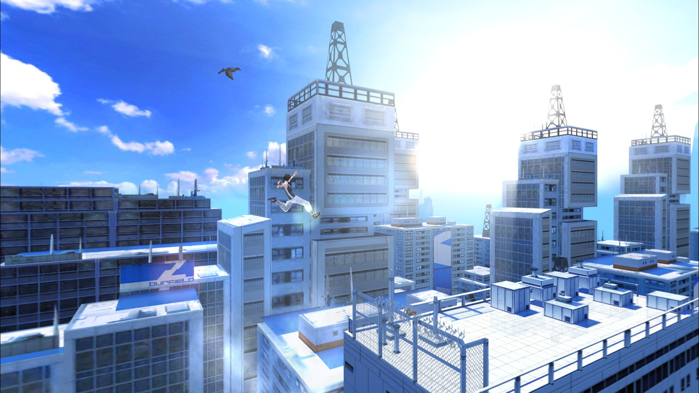
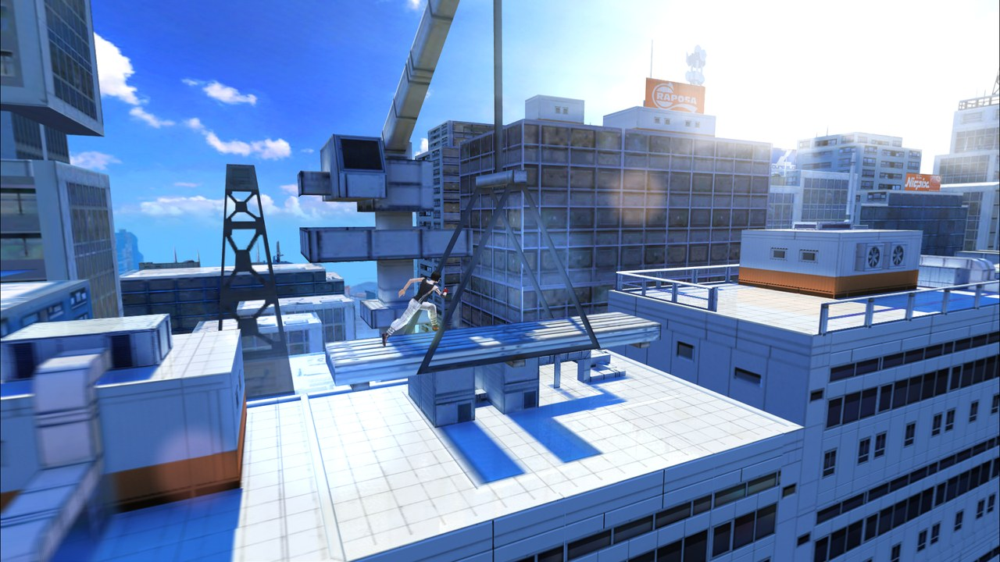
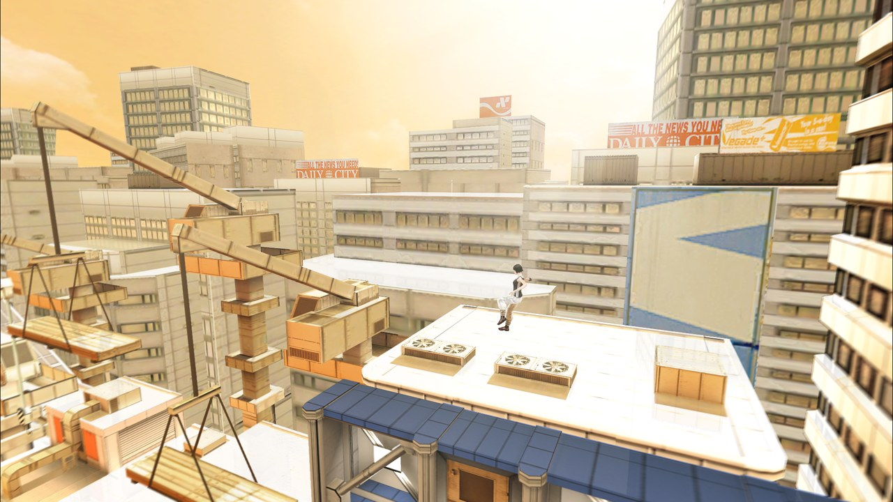
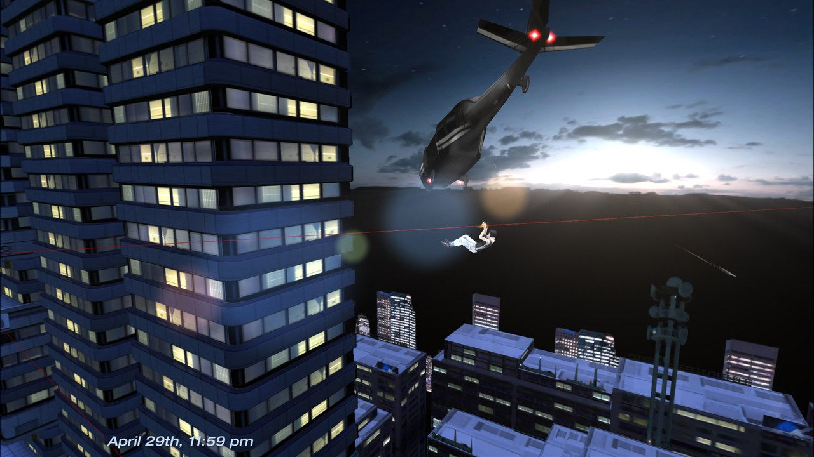
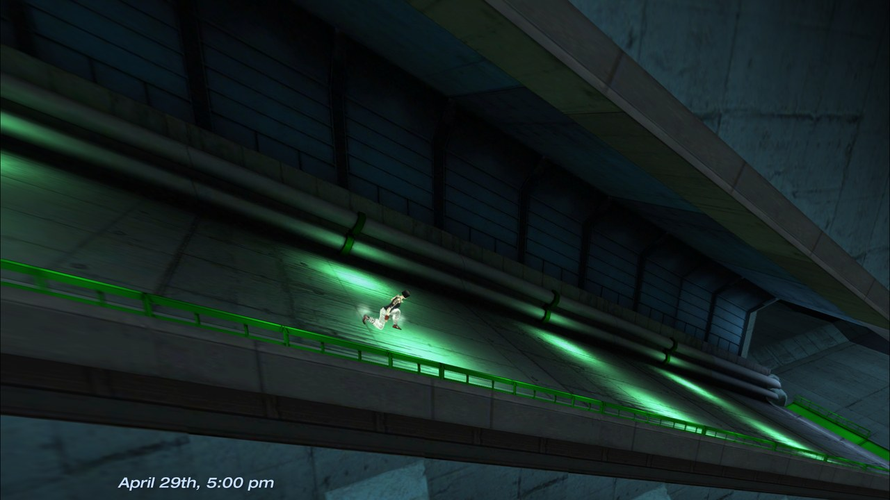
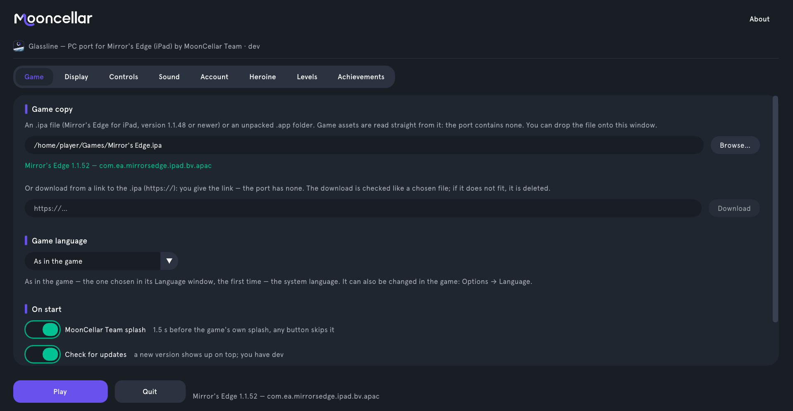

<p align="center">
  
</p>

<h1 align="center">Glassline</h1>

<p align="center">An unofficial port of <b>Mirror's Edge (iPad, 2010)</b> to PC, Android and the browser, by MoonCellar Team.<br>
<a href="https://play.mooncellar.space/glassline/"><b>Play in browser</b></a> · <a href="#how-to-play"><b>Download and install</b></a> · <a href="README.ru.md">Русская версия</a></p>

> Glassline is an unofficial port by MoonCellar Team. Mirror's Edge is a trademark of Electronic Arts
> Inc.; this project is not affiliated with or endorsed by Electronic Arts. Game assets are loaded
> from your own copy of the game, which you choose or download yourself; the port holds no rights to
> the game. Mirror's Edge © EA / DICE. All Rights Reserved.

Glassline runs the iPad game on Linux, Windows, Steam Deck and Android, and in browsers on computers,
phones and tablets. The game code was
reconstructed from the iPad executable; the port replaces iOS with its own layer over SDL2, OpenGL ES,
OpenAL and FFmpeg, adds a launcher, network play and MoonCellar online services in place of EA's,
which are long gone. **No game files are included**: you need your own copy of the iPad version.
Source code, releases and the changelog: [github.com/MoonCellar-Team/Glassline](https://github.com/MoonCellar-Team/Glassline).

<p align="center">
  
</p>
<p align="center">
  
  
  
  
</p>

## Features compared with the iPad original

<details>
<summary><b>Graphics and display</b></summary>

- Any resolution and aspect ratio: the 3D view fills 16:9, 16:10 and ultrawide screens up to 21:9
  with a corrected field of view; menus and HUD stay 4:3 in the centre, never stretched.
- Rendering at your screen's resolution (tested at 1440p and 4K) with sharp text, or at 75 % / 50 %
  with AMD FSR 1.0, bilinear or integer upscaling.
- Frame rate 30 (as on iPad), 60, 120, 144 or 165 (up to what your display shows), your display's rate
  or unlimited; the game runs at the same speed at any rate. VSync, monitor and fullscreen resolution choice; windowed, fullscreen
  or borderless on desktop (F11 or Alt+Enter in game).
- Anisotropic filtering up to 16×, MSAA 2×/4×/8×, optional TAA.
- Optional enhanced look: bloom, tone mapping, colour grading (presets or your own LUT), vignette.
  Optional effects, all off by default: ambient occlusion (SSAO, HBAO, GTAO), god rays, sun lens
  flare, reflections on glossy floors, motion blur, real-time shadows of the runners.
- One **Original / Remastered** switch: Original shows exactly the iPad picture (4:3, 30 fps).
- Texture replacement by hash; HD textures can be generated on your own PC (Real-ESRGAN on the GPU)
  and stay on your machine. F12 saves a screenshot.

</details>

<details>
<summary><b>Controls</b></summary>

- Keyboard and gamepad everywhere, menus included; mouse and touchscreen work as touches.
- Separate rebinding for keyboard and gamepad in the launcher, stick dead zone.
- Tutorial hints and the Help screen follow your input: keyboard keys, gamepad buttons, or touch gestures.
- Touch players have an on-screen pause button; a two-finger downward swipe also pauses.
- Combat slow motion can be switched off on the launcher's Game tab.
- Text (names, challenge comments, room codes) is typed straight into the game.
- Steam Deck: add the AppImage as a non-Steam game and play in Game Mode; fullscreen, Steam Input
  and the on-screen keyboard work, and the launcher is fully usable with the buttons.

</details>

<details>
<summary><b>Network play</b></summary>

- Online one-on-one in both of the original's two-player modes: **Race** (a time trial against each
  other) and **Rivals** (collect bags on a shared map in 2, 3 or 5 minutes); takedowns between
  players can be switched on or off.
- MULTIPLAYER is in the EXTRAS menu: the host presses CREATE GAME and gets a four-character room code,
  the friend enters it under JOIN GAME. Direct peer-to-peer connection without port forwarding, with a
  MoonCellar relay when no direct path is found. No account needed.
- Your opponent sees your skin, including custom models; police are shared (a takedown or disarm
  counts for both players) and shoot at both of you.
- Tags over the runners (YOU and your friend's name) and an arrow at the screen edge show where your
  friend is; pop-ups say when the friend joins, is ready to start, leaves or loses the connection.
  After a race the host picks the next level with SELECT, and the friend follows.
- The original split-screen mode is on PC too (SPLITSCREEN in the same lobby, a second gamepad; halves top and bottom, full width), and
  player-made levels can be played together: the other player receives the level automatically. Players on PC,
  Android and browsers can race together. Both players and hazards wait until everyone is ready and the
  countdown ends.

</details>

<details>
<summary><b>Online services instead of EA (MoonCellar)</b></summary>

- Sign in to a MoonCellar account from the launcher with a code or QR code confirmed on
  mooncellar.space; no password is typed into the game. Without an account the game works offline.
- Global leaderboards per level with downloadable ghosts; challenges to MoonCellar friends with your
  time and ghost.
- Cloud saves: progress, achievements, ghosts, language, sound and control settings, your skins (up to
  10 in the cloud, with additional skins kept locally) and levels; display and graphics stay per device.
  On a conflict you choose which
  copy to keep, the other is backed up.
- 28 achievements with their own texts and icons, a launcher tab with progress, and your profile on
  mooncellar.space.
- EA-only menu items (More Games, Origin, Facebook, usage data) are removed; no telemetry.

</details>

<details>
<summary><b>Launcher</b></summary>

- Tabs: Game, Display, Controls, Sound, Account, Heroine, Levels, Achievements; English or Russian.
- Choose your game copy with Browse…. On desktop you can also drag and drop, enter a path, or download
  it from your own HTTPS link. The copy is checked at once: green — fine, yellow — a warning, red — what
  is wrong.
- Game language, combat slow motion, desktop window settings, and on Linux Wayland or X11. Works with a
  gamepad and with touch.
- Setting explanations open from info buttons by hovering or tapping. Ctrl+Tab and Ctrl+Shift+Tab switch tabs.
- In mobile browsers, the compact launcher scrolls by touch and keeps Play accessible in the bottom footer.
- In the game's main menu: INFO → LAUNCHER; desktop and Android also have QUIT GAME. Close the tab to
  leave the browser version.
- Updates itself: at start the launcher checks for a new release and shows what's new; **Update**
  downloads the AppImage or the Windows zip, checks its signature and restarts on the new version. Your
  game copy, saves and settings stay. Other installs (the `.tar.gz` folder, Android) get a link to the
  release page. Switch it off on the Game tab ("Check for updates") or with `--no-update`.



</details>

<details>
<summary><b>Heroine skins</b></summary>

- Faith's look with previews (lighting variants, the ghost, the rival runner, the boss).
- Your own texture skins made from a template of your copy, and your own 3D models (glTF, GLB, VRM)
  with automatic rigging for Mixamo, Unity and VRM skeletons; all game animations work.
- Heroine cards show whether each custom skin is in the cloud, waiting to sync, or local only.
  Choose which skins to sync; when the cloud is full, additional skins stay on this device. Resetting
  cloud storage preserves your local skins.

</details>

<details>
<summary><b>Player levels and level editor</b></summary>

- A side-view level editor: blocks and ramps to run on, scenery pieces from the game's palette (in
  groups, mirrored if needed, set in depth with a top view), bags, checkpoints with their turning dish,
  ziplines, swing bars, music, start and finish. A block can be a wall-run, balance-beam or long-jump
  zone, or wear a building's facade. Group selection, resize handles, 200 undo steps; Test (F5) runs
  the level.
- The editor opens from the launcher's **Levels** tab (Create level, Edit). There a level also
  uploads, updates online, unpublishes, deletes, and exports to a `.glevel` file that Import level…
  (or dropping the file onto the launcher) opens on another device — no account needed.
- Two kinds of levels: Race and Bag collection (Rivals Mode in the game's menus), built on any chapter
  or, for Bag collection, on a BAG HUNT arena. PLAYER LEVELS in the EXTRAS menu lists your own and
  downloaded levels.
- BAG HUNT in the PLAY menu: collect bags alone on the original two-player arenas (Steps, Joust,
  Pinball, Maze) or on Bag collection levels within 2, 3 or 5 minutes; the best haul is kept.
- Online level browser (PLAYER LEVELS → ONLINE): search, sort, filter by mode, rate with a one-to-five-star
  picker and confirmation, report, download and play; MY LEVELS uploads and unpublishes your own. Every
  shared level has its own leaderboard and
  can be sent to a friend as a challenge. Levels hold only the layout: models and textures come from
  each player's copy, so only levels built from scratch are shared — a copy of a chapter or arena stays
  on your device.
- **[Level editor guide](docs/editor/README.md)** — every panel and tool, how to add each object, and
  step-by-step examples (a building, a billboard to run on, a wall run, swing bars, checkpoint dishes).

</details>

<details>
<summary><b>Languages and audio</b></summary>

- All 8 languages of the game (English, French, Italian, German, Spanish, Japanese, Korean,
  Chinese), selectable in the launcher; input hints adapt to your device, and the port's new menus
  are translated into all 8.
- Russian too, which the iPad original never had: the port's own translation of every game text and
  menu.
- Master volume, headphone surround (HRTF), your own music folder (MP3, OGG, Opus, FLAC, WAV, M4A…)
  instead of the soundtrack, like iPod music on the iPad.

</details>

<details>
<summary><b>Browser version</b></summary>

- [Play at play.mooncellar.space/glassline](https://play.mooncellar.space/glassline/) in a recent Chrome,
  Edge, Firefox or Safari 17 or newer, including Safari on iPhone and iPad. Choose your own iPad `.ipa`
  with Browse in the launcher: the game copy stays in this browser profile and is never uploaded.
- The loading screen shows download and preparation progress. The browser version includes sound,
  music, MoonCellar accounts and cloud saves, leaderboards, achievements, skins and the level editor.
- Online play works between browsers and with desktop and Android players through the room relay.
- Touch and tilt work on phones and tablets. Allow motion access if the browser asks; Add to Home Screen
  opens the game as a standalone app where supported.
- Display offers Follow device, Landscape and Portrait, plus Start in fullscreen when the browser
  supports it. Image and touch coordinates rotate even without browser orientation locking.
- The mobile level editor has compact tools, a smaller top view and touch scrolling in long panels.
  The web version updates when the page is reloaded.

</details>

<details>
<summary><b>Android</b></summary>

- Phones and tablets with Android 9 or newer, always in landscape; your .ipa is picked with the system
  file picker and copied into the app. Exported levels and the Blender skin template go to
  Download/MoonCellar.
- Touch controls as on the iPad, tilt with the accelerometer, gamepads; the same launcher,
  multiplayer (with PC players too, or two on one tablet) and a touch level editor.

</details>

## Known limitations

- You need the **iPad** version of Mirror's Edge, 1.1.48 or newer (1.1.48 and 1.1.52 are tested).
  The iPhone version is not supported: it has no multiplayer and a phone screen layout.
- No native macOS release yet; use the browser version on macOS. The launcher updates itself only as the
  AppImage or the Windows zip;
  the `.tar.gz` folder and the Android APK are updated by hand (the launcher links the release).
- Enhanced graphics and effects need OpenGL ES 3.0; on older drivers they are switched off.
  HD texture generation needs a Vulkan GPU and up to 3 GB of disk space, takes half an hour or more and
  runs on PC only.
- Online features depend on MoonCellar's servers.
- The browser needs WebAssembly threads, OPFS storage and WebGL in a worker; unsupported browsers show
  an explanation before downloading the game program. Clearing site data removes the local game copy
  and local saves; cloud-synced data can be restored after signing in.
- Online play is one-on-one only. Police AI runs on each machine separately: only takedowns and
  disarms are shared, and combat slow motion is off in online play.
- The friends-only leaderboard (formerly Facebook) is empty; global leaderboards work.
- Split-screen on PC needs a second gamepad for player two.

## How to play

1. **Get your own copy** of Mirror's Edge for iPad (version 1.1.48 or newer) as an `.ipa` file (on PC
   an unpacked `.app` folder works too).
   An encrypted App Store copy works: the port does not use the game's executable, only its
   resources, and reads them straight from the `.ipa`.
2. **Open [Play in browser](https://play.mooncellar.space/glassline/)**, or download a build from the
   [Releases](https://github.com/MoonCellar-Team/Glassline/releases) page:
   - Linux: `glassline-linux-x64-<version>.AppImage` (one file; make it executable and run it) or
     `glassline-linux-x64-<version>.tar.gz` (a folder with `glassline` and its libraries). Any x86-64
     Linux with glibc 2.28 or newer, X11 or Wayland; everything except the GPU driver is included.
   - Windows: `glassline-windows-x64-<version>.zip` — unpack it and run `Glassline.exe`.
     Windows 10 or 11, 64-bit.
   - Android: `glassline-android-<version>.apk` — Android 9 or newer, ARM.
   - Steam Deck: in Desktop Mode add the AppImage to Steam with "Add a Non-Steam Game…", then start
     it from Game Mode.
3. **Start it.** On the launcher's **Game** tab choose your `.ipa` with **Browse…**. Desktop builds also
   accept dropping the file onto the window or downloading your own HTTPS link. When the check turns
   green, press **Play**. The copy is remembered; in the browser, the loading screen shows progress.
4. **Controls** (rebind them on the launcher's **Controls** tab):

   | Action | Keyboard | Gamepad |
   |---|---|---|
   | Run left / right, turn | A / D or ← / → | left stick or D-pad |
   | Jump, climb, grab | W or ↑ | A |
   | Slide, roll, drop | S or ↓ | B |
   | Tap (stop) | Space or Enter | X |
   | Two-finger swipe left / right | Z / C or Shift + ← / → | LB / RB |
   | Tilt (balance, zipline speed) | Q / E | right stick |
   | Pause | Esc or P | Start |

   In menus: arrows or the stick move, Enter or A confirms, Esc or B goes back. The mouse and the
   touchscreen work as touches. On desktop: F11 or Alt+Enter — fullscreen, F12 — screenshot.
   On touchscreens: swipe left/right to run or turn, up to jump or climb, down to slide or drop; tap
   to stop. Pause with the on-screen button or a two-finger downward swipe. Tilt to balance.
   Browser orientation and fullscreen are selected on the launcher's Display tab.
5. **Your data** — settings, saves, skins, levels, logs:
   - Linux: `~/.local/share/mirrors-edge` (or `$XDG_DATA_HOME/mirrors-edge`);
   - Windows: `%APPDATA%\mirrors-edge`;
   - Android: the app's own storage;
   - Browser: this site's storage in the browser profile; sign in for cloud sync.

   The log of the last run is `medecomp.log` in that folder (on Linux also the one before —
   `medecomp.prev.log`; started from a terminal, the log goes to the terminal), network play writes
   `net.log` (the one before — `net.prev.log`). Attach them when you report a problem.

   On PC, screenshots (F12) and wallpapers saved in the game go to `Pictures/Glassline` in your home
   folder.

Command line: `glassline <path to .ipa>` opens the launcher with that copy, `--no-launcher` starts the
game straight away (with the last copy), `--launcher` always shows the launcher.

## Building from source

The release builds are made by `build.sh` on a Linux x86-64 machine.
If the host lacks build tools (for example, on SteamOS), the script checks existing Distrobox
containers and builds in the first suitable one. Use `MEDECOMP_DISTROBOX=Archlinux ./build.sh windows`
to select a container, or `./build.sh --check all` to check the tools without building.
The project must be accessible at the same path inside the container. No containers or system
packages are installed automatically; checking a stopped container may start it.
Linux releases keep using the dedicated manylinux container through Podman or Docker.

Targets:

```sh
./build.sh linux      # build/release/: AppImage, tar.gz, linux/ — needs podman or docker
./build.sh windows    # build/release/: Windows zip — cross-compiled, needs clang, CMake, Python 3
./build.sh android    # build/release/: APK — downloads its own JDK, Android SDK, NDK and Gradle
./build.sh web        # build/release/web and a zip: the browser version — needs emsdk, meson, ninja
./build.sh all 1.0    # all three, with a version number in the names
./run.sh              # run the Linux build (./run.sh windows — under wine)
./run.sh android-emulator  # start the emulator, install a compatible APK and launch Glassline
```

Android commands use an existing suitable Distrobox if the SDK tools cannot run on the host.
Use `MEDECOMP_DISTROBOX=Archlinux ./run.sh android-emulator` to select one explicitly.
`--check` checks the tools and acceleration without starting the emulator; `--list-avds` lists
virtual devices. Pass an AVD name after `android-emulator`, or emulator arguments after `--`.
Without an existing AVD, the installed Android 35 x86_64 image is used to create a project AVD
in `build/android/avd`. Missing SDK packages are not downloaded automatically.
The command waits for Android to boot, then installs the newest compatible APK from `build/release`
or `build/android` and launches Glassline. It reuses the selected AVD if already running.
`--no-app` starts only the emulator. `./run.sh android --apk <path> --serial <serial>` installs
and launches an APK on a connected device. An x86_64 emulator needs an APK built with x86_64 support
(`android/build.sh x86_64`); missing APKs are not built automatically.

The Linux build runs in a container on an old glibc (2.28), so it works on any newer Linux; the
first run prepares the container image (about 20 minutes). The Windows build downloads its compiler
(llvm-mingw) and libraries (MSYS2 packages) by itself. Libraries with network and audio code
(GameNetworkingSockets, FFmpeg) are built from pinned sources.

The browser version (WebAssembly) needs Emscripten (`source ~/emsdk/emsdk_env.sh`), meson and ninja;
`tools/web_deps.py` builds the libraries Emscripten has no ports of (OpenAL Soft, cairo, pixman) from
pinned sources. Try it locally with `./run.sh web` (the page needs the `Cross-Origin-Opener-Policy` and
`Cross-Origin-Embedder-Policy` headers, which this server sends) and open http://localhost:8090/. The game copy
you choose stays in the browser's storage. It runs in a recent Chrome, Edge, Firefox or Safari 17 and newer;
WebKitGTK browsers (GNOME Web) lack WebAssembly threads, OPFS and WebGL in workers, and the page says so.

For development, a build against your system's libraries (Debian or Ubuntu package names are in
`port/src/*/apt.txt`, plus clang, CMake and Python 3):

```sh
cmake -S port -B build/port64 -DMEDECOMP_M32=OFF -DCMAKE_C_COMPILER=clang -DCMAKE_CXX_COMPILER=clang++
cmake --build build/port64 -j
build/port64/medecomp
```

The code: `src/` and `include/` — the game, reconstructed from the iPad executable; `port/` — the
port: platform layers in `port/src/` (iOS frameworks, graphics, audio, network, online services,
launcher, level editor) and third-party code in `port/third_party/`; `android/` — the Android app.

## AI Disclosure

AI helped with the development: [Claude Code](https://claude.com/claude-code) (Claude, by Anthropic)
decompiled the game function by function from its ARM assembly and helped write the port and its tools.

## License

Glassline is source-available, not open source: see [LICENSE](LICENSE). You may read and study the
code, and build and play it with your own copy of the game; distributing builds or modified
versions, and other or commercial use, need permission. The rights to Mirror's Edge, its code and its
resources belong to Electronic Arts; the license covers only MoonCellar Team's own work.

Third-party code is under its own licenses: Dear ImGui (MIT, `port/third_party/imgui`), stb_image
(MIT or public domain), GameNetworkingSockets (BSD-3-Clause), and in the release builds SDL2, OpenAL
Soft, FFmpeg, cairo, FreeType, fontconfig, libcurl, ANGLE and others, with their license texts in the
`licenses` folder of each build. The Windows build also carries Microsoft's D3D shader compiler
(`d3dcompiler_47.dll`, redistributable code of the Windows SDK, under the Windows SDK license): ANGLE builds
shaders with it, and under Wine and Proton it is what makes floor reflections work.

Changes between versions: [CHANGELOG.md](CHANGELOG.md).
