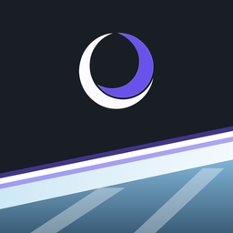

<p align="center">
  
</p>

<h1 align="center">Glassline</h1>

<p align="center">An unofficial port of <b>Mirror's Edge (iPad, 2010)</b> to PC and Android, by MoonCellar Team.<br>
<a href="README.ru.md">Русская версия</a></p>

> Glassline is an unofficial port by MoonCellar Team. Mirror's Edge is a trademark of Electronic Arts
> Inc.; this project is not affiliated with or endorsed by Electronic Arts. Game assets are loaded
> from your own copy of the game, which you choose or download yourself; the port holds no rights to
> the game. Mirror's Edge © EA / DICE. All Rights Reserved.

Glassline runs the iPad game on Linux, Windows, Steam Deck and Android. The game code was
reconstructed from the iPad executable; the port replaces iOS with its own layer over SDL2, OpenGL ES,
OpenAL and FFmpeg, adds a launcher, network play and MoonCellar online services in place of EA's,
which are long gone. **No game files are included**: you need your own copy of the iPad version.
Source code, releases and the changelog: [github.com/MoonCellar-Team/Glassline](https://github.com/MoonCellar-Team/Glassline).

## Features compared with the iPad original

**Graphics and display**
- Any resolution and aspect ratio: the 3D view fills 16:9, 16:10 and ultrawide screens up to 21:9
  with a corrected field of view; menus and HUD stay 4:3 in the centre, never stretched.
- Rendering at your screen's resolution (tested at 1440p and 4K) with sharp text, or at 75 % / 50 %
  with AMD FSR 1.0, bilinear or integer upscaling.
- Frame rate 30 (as on iPad), 60, 120, 144, 165, your display's rate or unlimited; the game runs at
  the same speed at any rate. VSync, monitor and fullscreen resolution choice; windowed, fullscreen
  or borderless (F11 or Alt+Enter in game).
- Anisotropic filtering up to 16×, MSAA 2×/4×/8×, optional TAA.
- Optional enhanced look: bloom, tone mapping, colour grading (presets or your own LUT), vignette.
  Optional effects, all off by default: ambient occlusion (SSAO, HBAO, GTAO), god rays, sun lens
  flare, reflections on glossy floors, motion blur, real-time shadows of the runners.
- One **Original / Remastered** switch: Original shows exactly the iPad picture (4:3, 30 fps).
- Texture replacement by hash; HD textures can be generated on your own PC (Real-ESRGAN on the GPU)
  and stay on your machine. F12 saves a screenshot.

**Controls**
- Keyboard and gamepad everywhere, menus included; mouse and touchscreen work as touches.
- Separate rebinding for keyboard and gamepad in the launcher, stick dead zone.
- Tutorial hints show the keys or buttons of the device you are using instead of swipes and
  "tilt the device".
- Text (names, challenge comments, room codes) is typed straight into the game.
- Steam Deck: add the AppImage as a non-Steam game and play in Game Mode; fullscreen, Steam Input
  and the on-screen keyboard work, and the launcher is fully usable with the buttons.

**Network play**
- Online one-on-one in both of the original's two-player modes: **Race** (a time trial against each
  other) and **Rivals** (collect bags on a shared map in 2, 3 or 5 minutes); takedowns between
  players can be switched on or off.
- The host creates a game and gets a four-character room code; the friend enters it. Direct
  peer-to-peer connection without port forwarding, with a MoonCellar relay when no direct path is
  found. No account needed.
- Your opponent sees your skin, including custom models; police are shared (a takedown or disarm
  counts for both players) and shoot at both of you.
- The original split-screen mode is on PC too (second gamepad; halves top and bottom, full width), and
  player-made levels can be played together: the other player receives the level automatically. PC and
  Android play together.

**Online services instead of EA (MoonCellar)**
- Sign in to a MoonCellar account from the launcher with a code or QR code confirmed on
  mooncellar.space; no password is typed into the game. Without an account the game works offline.
- Global leaderboards per level with downloadable ghosts; challenges to MoonCellar friends with your
  time and ghost.
- Cloud saves: progress, achievements, ghosts, options, your skins and levels; on a conflict you
  choose which copy to keep, the other is backed up.
- 28 achievements with their own texts and icons, a launcher tab with progress, and your profile on
  mooncellar.space.
- EA-only menu items (More Games, Origin, Facebook, usage data) are removed; no telemetry.

**Launcher**
- Tabs: Game, Display, Controls, Sound, Account, Heroine, Levels, Achievements; English or Russian.
- Choose your game copy with Browse…, drag and drop or a path, or download it from your own HTTPS
  link. The copy is checked at once: green — fine, yellow — a warning, red — what is wrong.
- Game language, window size, and on Linux Wayland or X11. Works with a gamepad and with touch.
- In the game's main menu: INFO → LAUNCHER and QUIT GAME.
- Updates itself: at start the launcher checks for a new release and shows what's new; **Update**
  downloads the AppImage or the Windows zip, checks its signature and restarts on the new version. Your
  game copy, saves and settings stay. Other installs (the `.tar.gz` folder, Android) get a link to the
  release page. Switch it off on the Game tab ("Check for updates") or with `--no-update`.

**Heroine skins**
- Faith's look with previews (lighting variants, the ghost, the rival runner, the boss).
- Your own texture skins made from a template of your copy, and your own 3D models (glTF, GLB, VRM)
  with automatic rigging for Mixamo, Unity and VRM skeletons; all game animations work.

**Player levels and level editor**
- A side-view level editor: blocks, ramps, scenery pieces from the game's palette, bags,
  checkpoints, ziplines, music markers, start and finish; 200 undo steps; Test (F5) runs the level.
- Two kinds of levels: Race and Bag collection. PLAYER LEVELS in the EXTRAS menu lists your own and
  downloaded levels.
- Online level browser: upload, search, sort, rate, report, download and play; every shared level has
  its own leaderboard. Levels hold only the layout: models and textures come from each player's copy.
- **[Level editor guide](docs/editor/README.md)** — every panel and tool, how to add each object, and
  step-by-step examples (a building, a billboard to run on, a wall run, swing bars, checkpoint dishes).

**Languages and audio**
- All 8 languages of the game (English, French, Italian, German, Spanish, Japanese, Korean,
  Chinese), selectable in the launcher; texts about tapping, swiping and the iPad are replaced with
  neutral ones, and the port's new menus are translated into all 8.
- Master volume, headphone surround (HRTF), your own music folder (MP3, OGG, Opus, FLAC, WAV, M4A…)
  instead of the soundtrack, like iPod music on the iPad.

**Android**
- Phones and tablets with Android 9 or newer; your .ipa is picked with the system file picker.
- Touch controls as on the iPad, tilt with the accelerometer, gamepads; the same launcher,
  multiplayer (with PC players too, or two on one tablet) and a touch level editor.

## Known limitations

- You need the **iPad** version of Mirror's Edge, 1.1.48 or newer (1.1.48 and 1.1.52 are tested).
  The iPhone version is not supported: it has no multiplayer and a phone screen layout.
- No macOS version, not on Steam. The launcher updates itself only as the AppImage or the Windows zip;
  the `.tar.gz` folder and the Android APK are updated by hand (the launcher links the release).
- Enhanced graphics and effects need OpenGL ES 3.0; on older drivers they are switched off.
  HD texture generation needs a Vulkan GPU, takes half an hour or more and runs on PC only.
- Online features depend on MoonCellar's servers.
- Online play is one-on-one only. Police AI runs on each machine separately: only takedowns and
  disarms are shared, and combat slow motion is off in online play.
- The friends-only leaderboard (formerly Facebook) is empty; global leaderboards work.
- Split-screen on PC needs a second gamepad for player two.
- The game itself has no Russian translation (the original never had one).

## How to play

1. **Get your own copy** of Mirror's Edge for iPad (version 1.1.48 or newer) as an `.ipa` file.
   An encrypted App Store copy works: the port does not use the game's executable, only its
   resources, and reads them straight from the `.ipa`.
2. **Download a build** from the [Releases](https://github.com/MoonCellar-Team/Glassline/releases) page:
   - Linux: `glassline-linux-x64-<version>.AppImage` (one file; make it executable and run it) or
     `glassline-linux-x64-<version>.tar.gz` (a folder with `glassline` and its libraries). Any x86-64
     Linux with glibc 2.28 or newer, X11 or Wayland; everything except the GPU driver is included.
   - Windows: `glassline-windows-x64-<version>.zip` — unpack it and run `Glassline.exe`.
     Windows 10 or 11, 64-bit.
   - Android: `glassline-android-<version>.apk` — Android 9 or newer, ARM.
   - Steam Deck: in Desktop Mode add the AppImage to Steam with "Add a Non-Steam Game…", then start
     it from Game Mode.
3. **Start it.** The launcher opens: on the **Game** tab choose your `.ipa` (Browse…, drag the file
   onto the window, or paste an HTTPS link to your copy and press Download). When the check turns
   green, press **Play**. The copy is remembered.
4. **Controls** (rebind them on the launcher's **Controls** tab):

   | Action | Keyboard | Gamepad |
   |---|---|---|
   | Run left / right, turn | A / D or ← / → | left stick or D-pad |
   | Jump, climb, grab | W or ↑ | A |
   | Slide, roll, drop | S or ↓ | B |
   | Tap (stop) | Space or Enter | X |
   | Two-finger swipe left / right | Z / C or Shift + ← / → | LB / RB |
   | Tilt (balance, zipline speed) | Q / E | right stick |
   | Pause | Esc or P | Start |

   In menus: arrows or the stick move, Enter or A confirms, Esc or B goes back. The mouse and the
   touchscreen work as touches. F11 or Alt+Enter — fullscreen, F12 — screenshot.
5. **Your data** — settings, saves, skins, levels, logs:
   - Linux: `~/.local/share/mirrors-edge` (or `$XDG_DATA_HOME/mirrors-edge`);
   - Windows: `%APPDATA%\mirrors-edge`;
   - Android: the app's own storage.

   The log of the last run is `medecomp.log` in that folder (the one before — `medecomp.prev.log`),
   network play writes `net.log`. Attach them when you report a problem.

Command line: `glassline <path to .ipa>` opens the launcher with that copy, `--no-launcher` starts the
game straight away (with the last copy), `--launcher` always shows the launcher.

## Building from source

The release builds are made by `build.sh` on a Linux x86-64 machine:

```sh
./build.sh linux      # build/release/: AppImage, tar.gz, linux/ — needs podman or docker
./build.sh windows    # build/release/: Windows zip — cross-compiled, needs clang, CMake, Python 3
./build.sh android    # build/release/: APK — downloads its own JDK, Android SDK, NDK and Gradle
./build.sh all 1.0    # all three, with a version number in the names
./run.sh              # run the Linux build (./run.sh windows — under wine)
```

The Linux build runs in a container on an old glibc (2.28), so it works on any newer Linux; the
first run prepares the container image (about 20 minutes). The Windows build downloads its compiler
(llvm-mingw) and libraries (MSYS2 packages) by itself. Libraries with network and audio code
(GameNetworkingSockets, FFmpeg) are built from pinned sources.

For development, a build against your system's libraries (Debian or Ubuntu package names are in
`port/src/*/apt.txt`, plus clang, CMake and Python 3):

```sh
cmake -S port -B build/port64 -DMEDECOMP_M32=OFF -DCMAKE_C_COMPILER=clang -DCMAKE_CXX_COMPILER=clang++
cmake --build build/port64 -j
build/port64/medecomp
```

The code: `src/` and `include/` — the game, reconstructed from the iPad executable; `port/` — the
port: platform layers in `port/src/` (iOS frameworks, graphics, audio, network, online services,
launcher, level editor) and third-party code in `port/third_party/`; `android/` — the Android app.

## How it was made

AI helped with the development: [Claude Code](https://claude.com/claude-code) (Claude, by Anthropic)
decompiled the game function by function from its ARM assembly and helped write the port and its tools.

## License

Glassline is source-available, not open source: see [LICENSE](LICENSE). You may read and study the
code, and build and play it with your own copy of the game; distributing builds or modified
versions, and other or commercial use, need permission. The rights to Mirror's Edge, its code and its
resources belong to Electronic Arts; the license covers only MoonCellar Team's own work.

Third-party code is under its own licenses: Dear ImGui (MIT, `port/third_party/imgui`), stb_image
(MIT or public domain), GameNetworkingSockets (BSD-3-Clause), and in the release builds SDL2, OpenAL
Soft, FFmpeg, cairo, FreeType, fontconfig, libcurl, ANGLE and others, with their license texts in the
`licenses` folder of each build.

Changes between versions: [CHANGELOG.md](CHANGELOG.md).
